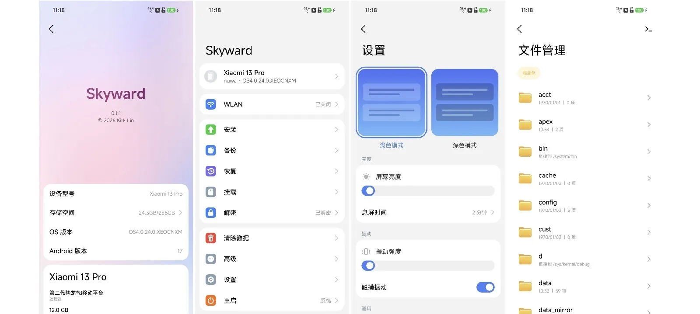

# Skyward for nuwa

English | [简体中文](README.zh-CN.md)

Skyward is a recovery written in Rust, from scratch. This fork is dedicated to
one phone: the **Xiaomi 13 Pro** (codename `nuwa`). For the other devices the
upstream project supports, see [kirklin/skyward](https://github.com/kirklin/skyward).



<p align="center">
  
  
  
</p>

## Features

- Decrypt the data partition
- Install zips, system update packages and partition images, from internal storage, a USB drive or adb sideload
- Online system updates
- Backup and restore
- Wipe data and factory reset
- Mount partitions, repair and format filesystems
- File manager and terminal
- WLAN
- MTP file transfer, adb and fastbootd
- Reboot to system, recovery, fastboot, bootloader or EDL, and switch slots
- Light and dark themes; Simplified Chinese, Traditional Chinese and English

## Supported device

| Device | Codename | Tested system version |
| --- | --- | --- |
| Xiaomi 13 Pro | `nuwa` | OS4.0.24.0.XEOCNXM (Android 17) |

The recovery image is built on the stock recovery of OS3.0.311.0.WMBCNXM, the
build `devices/nuwa.toml` names.

## Installing

Skyward needs an unlocked bootloader. Download the zip from this repository's
[Releases](https://github.com/pubglite55/skyward-for-nuwa/releases), which are
published from tags named `nuwa-v*`. Each file is named
`skyward-nuwa-<version>-<stock build>`. Check it against `SHA256SUMS.txt`,
unzip it, and flash the image inside to the recovery partition of the slot the
phone runs from, with the phone in fastboot mode:

```sh
unzip skyward-nuwa-v1.1-OS3.0.311.0.WMBCNXM.zip
fastboot flash recovery skyward-nuwa-v1.1-OS3.0.311.0.WMBCNXM.img
fastboot reboot recovery
```

Afterwards a newer image, unzipped, installs from Skyward's own Install page. With
**Flash Skyward again** on, a system update or zip that writes over the recovery
partitions gets Skyward back in them.

Without a system in super, Skyward still starts, with its screen and keys, adb,
`adb sideload` and fastbootd, enough to install one. Touch, WLAN and decryption run
from the installed system and come back with it.

adb in Skyward is a root shell that needs no authorization on the phone: anyone
with the phone and a cable can reach its storage while it is in recovery.

## Building

Skyward builds with the stable Rust that `rust-toolchain.toml` names, with its
`aarch64-linux-android` target, the Android NDK r29 and
[cargo-ndk](https://github.com/bbqsrc/cargo-ndk). The recovery service is built for
the phone, and the packer for the computer:

```sh
cargo ndk -t arm64-v8a --platform 30 build --release -p skyward
cargo build --release -p skyward-pack
```

The packer takes the stock recovery partition out of the build's full update
package on Xiaomi's server, reading only the part of the package the partition is
in, and checks its SHA-256 against the device file:

```sh
target/release/skyward-pack stock --config devices/nuwa.toml --out target/stock/nuwa/recovery.img
```

Then it builds the image on top of it:

```sh
target/release/skyward-pack recovery \
  --stock target/stock/nuwa/recovery.img \
  --binary target/aarch64-linux-android/release/skyward \
  --config devices/nuwa.toml \
  --font resources/fonts/MiSansVF.ttf \
  --mono resources/fonts/KirkMono-Regular.ttf \
  --mono-license resources/fonts/KirkMono-OFL.txt \
  --out target/skyward-nuwa.img
```

Tests and lints run on the computer; what runs only on the phone is linted for it:

```sh
cargo test --workspace
cargo clippy --workspace --all-targets -- -D warnings
cargo ndk -t arm64-v8a --platform 30 clippy -p skyward -p skyward-install -- -D warnings
```

`skyward-preview` draws the pages on the computer, as PNG files, without a phone:
each page whole, as a long screenshot shows it, in the states it can be in, and the
screen at moments of touches and motion. `--lang` picks the language by a locale
such as `en` or `zh-TW`:

```sh
cargo run --release -p skyward-preview -- target/preview --lang en
```

## License

[GPL-3.0-or-later](LICENSE)
